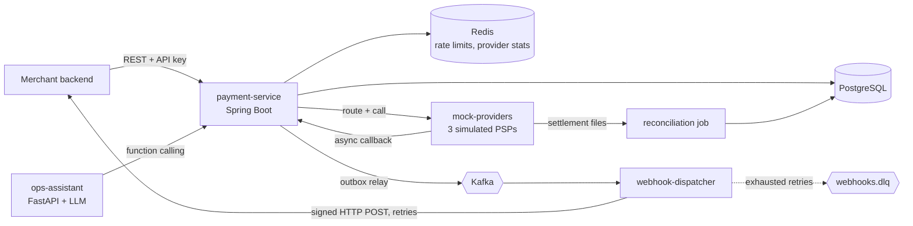
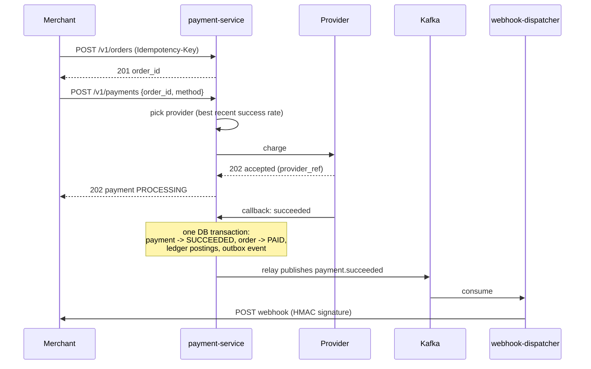

# Payrail: System Design

## 1. Problem

Merchants need to accept online payments without integrating with every payment provider
themselves. Payrail sits between merchants and providers: it creates orders, routes each payment
to the healthiest provider, records every rupee in a double-entry ledger, notifies merchants via
webhooks, and reconciles daily against provider settlement reports.

## 2. Requirements

### Functional
1. Merchants authenticate with API keys and create orders.
2. Customers pay an order via UPI, card, or netbanking.
3. Payrail routes each payment to one of several providers based on recent success rates.
4. Every successful payment is recorded in a double-entry ledger.
5. Merchants receive signed webhooks for payment events, with retries.
6. A daily job reconciles the ledger against provider settlement files and flags mismatches.
7. An ops assistant answers questions like "why did payment X fail?" in plain language.

### Non-functional
| Property | Target |
| --- | --- |
| Correctness | No double charges, no lost payments, ledger always balances |
| Idempotency | Every write API safe to retry with an `Idempotency-Key` |
| Latency | p95 < 300 ms for API calls, excluding provider time |
| Availability | One provider failing must not stop payments (fail over to others) |
| Delivery | Webhooks delivered at least once; merchants dedupe by event id |
| Auditability | Ledger is append-only; every state change is traceable |

## 3. Back-of-the-envelope estimates

Assume 1M payments/day.
- Average load: 1,000,000 / 86,400 ≈ **12 payments/sec**; peak (10x, sale events) ≈ **120/sec**.
- Each payment ≈ 1 order + 1 payment + ~1.5 attempts + 1 ledger transaction with 3 entries
  + 2 outbox events ≈ **~3 KB** including indexes.
- Storage: 3 KB × 1M × 365 ≈ **~1.1 TB/year**, so plan for partitioning payments and
  ledger entries by month once volume grows.
- Webhooks: ~2 events per payment → ~24/sec average, ~240/sec peak.

A single well-indexed PostgreSQL primary handles this comfortably. Kafka decouples webhook
delivery so slow merchant endpoints never slow down payments.

## 4. Architecture

**Why this split:** payment-service owns all money-related state in one database, so orders,
payments, ledger, and outbox change atomically in a single transaction. Work that can be slow
or flaky (webhook delivery, reconciliation, AI) runs in separate services so it can never block
or corrupt a payment.

## 5. Payment flow

## 6. Ledger postings

For a ₹1,000 payment through provider A with a 2% Payrail fee:

| Account | Type | Amount (paise) |
| --- | --- | --- |
| provider_receivable:A | ASSET | +100000 (debit) |
| merchant_payable:<merchant> | LIABILITY | −98000 (credit) |
| fee_revenue | REVENUE | −2000 (credit) |
| **Sum** | | **0** |

The database enforces that every ledger transaction sums to zero (deferred constraint trigger)
and that entries are never updated or deleted.

## 7. Failure scenarios

| Scenario | Handling |
| --- | --- |
| Merchant retries a request after a timeout | Idempotency key returns the original response |
| Provider times out | Attempt recorded as TIMEOUT; payment stays PROCESSING; status checked later, never blindly retried on another provider (avoids double charge) |
| Provider is down | Circuit breaker opens; router stops sending traffic to it |
| Duplicate provider callback | Unique (provider, provider_ref) + state machine make it a no-op |
| Service crashes after DB commit, before Kafka publish | Outbox row still unpublished; relay publishes it on restart |
| Merchant webhook endpoint down | Exponential backoff retries, then dead-letter queue |
| Ledger doesn't match provider settlement | Reconciliation flags the mismatch for review |

## 8. Build steps

1. Design, local infra, payment-service skeleton, schema
2. Merchant API keys + orders API + idempotency
3. Mock providers + payment state machine + callbacks
4. Ledger postings
5. Outbox relay → Kafka; webhook-dispatcher with signatures, retries, DLQ
6. Smart routing (success rates in Redis) + circuit breakers
7. Rate limiting per merchant
8. Reconciliation pipeline
9. Ops assistant (LLM function calling)
10. Dockerfiles, Kubernetes (kind) + Helm
11. Terraform (AWS) + GitHub Actions CI/CD
12. Observability: metrics, dashboards, alerts, JSON logs
13. Load tests + failure drills (kill a provider mid-test)
14. Docs, results, demo video
